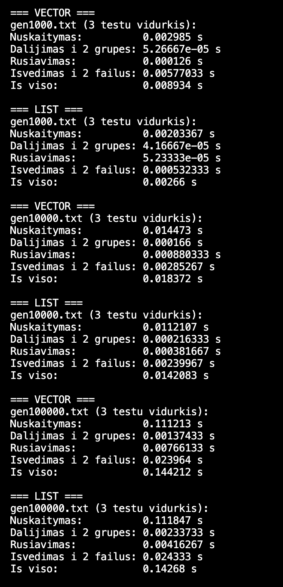
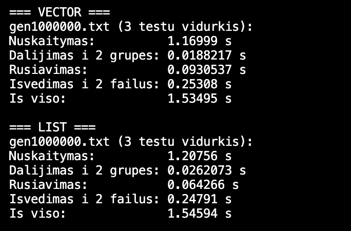
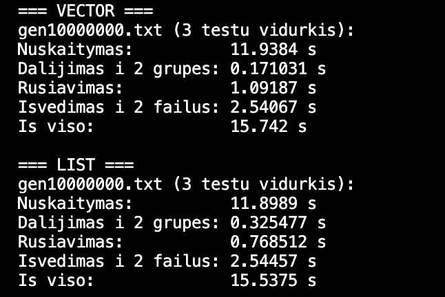
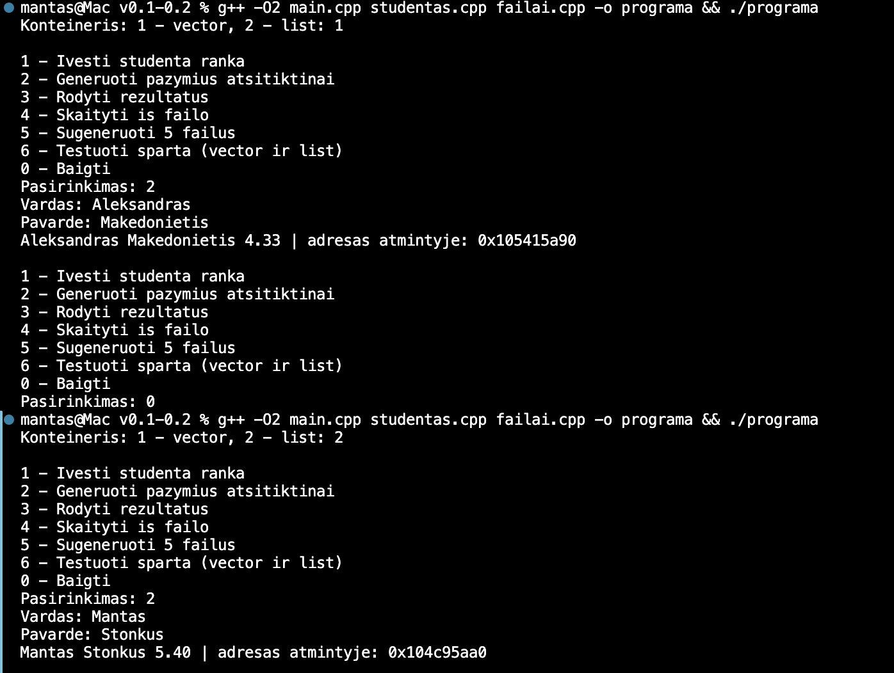

# Studentų balų skaičiuoklė v0.2

Programa sugeneruoja penkis studentų failus (1 000, 10 000, 100 000, 1 000 000 ir 10 000 000 įrašų), juos nuskaito, suskirsto studentus į dvi grupes ir išveda į du failus. Studentai, kurių galutinis balas mažesnis nei 5, įrašomi į vargsiukai.txt, o kiti į kietiakiai.txt. Galutinis balas skaičiuojamas taip: 0.4 * ND vidurkis + 0.6 * egzaminas.

Kodas išskaidytas į kelis failus. studentas.h ir studentas.cpp yra studento struktūra, balų skaičiavimas, skirstymas ir rūšiavimas. failai.h ir failai.cpp yra failų generavimas, skaitymas, rašymas ir testavimas. main.cpp yra meniu.

Paleidimas: g++ -O2 main.cpp studentas.cpp failai.cpp -o programa

Meniu 5 sugeneruoja failus, meniu 6 paleidžia greičio testą.

## Testavimas

Kiekvienas failas testuotas 3 kartus, rezultatai yra vidurkis sekundėmis. Studentai rūšiuoti pagal pavardę.

Failų kūrimas:
1 000 įrašų - 0.008 s
10 000 įrašų - 0.016 s
100 000 įrašų - 0.157 s
1 000 000 įrašų - 1.582 s
10 000 000 įrašų - 17.924 s

1 000 įrašų: nuskaitymas 0.005 s, dalijimas 0.000 s, rūšiavimas 0.0003 s, išvedimas 0.004 s, iš viso 0.010 s

10 000 įrašų: nuskaitymas 0.047 s, dalijimas 0.001 s, rūšiavimas 0.003 s, išvedimas 0.015 s, iš viso 0.066 s

100 000 įrašų: nuskaitymas 0.469 s, dalijimas 0.007 s, rūšiavimas 0.035 s, išvedimas 0.167 s, iš viso 0.678 s

1 000 000 įrašų: nuskaitymas 4.672 s, dalijimas 0.101 s, rūšiavimas 0.533 s, išvedimas 1.467 s, iš viso 6.774 s

10 000 000 įrašų: nuskaitymas 47.073 s, dalijimas 0.842 s, rūšiavimas 6.967 s, išvedimas 14.828 s, iš viso 69.710 s

Daugiausiai laiko užima failo nuskaitymas. Padidinus įrašų skaičių 10 kartų, laikas irgi išauga maždaug 10 kartų.

Kompiuteris: AMD Ryzen 5 3600X, 16 GB RAM, SSD

## v0.3 konteinerių testavimas (vector ir list)

Programa dabar veikia su dviem konteineriais: std::vector ir std::list. Konteineris pasirenkamas paleidus programą. Funkcijos padalinti, skaitytiFaila, spausdinti ir testas parašytos kaip šablonai (template), todėl tas pats kodas veikia su abiem. Rūšiavimui std::vector naudoja std::sort, o std::list turi savo funkciją list::sort.

Įvedant studentą ranka, šalia jo duomenų išvedamas objekto adresas atmintyje.

Testavimas atliktas kitame kompiuteryje nei v0.2, todėl failai sugeneruoti iš naujo programos 5 punktu (tokio paties formato ir dydžio). Abu konteineriai testuoti su tais pačiais failais. Kiekvienas failas testuotas 3 kartus, lentelėse vidurkis sekundėmis. Rūšiuota pagal pavardę.

### Testavimo sistema

| Parametras | Reikšmė |
|---|---|
| Kompiuteris | MacBook Air 13" (2025) |
| CPU | Apple M4 |
| RAM | 16 GB |
| Diskas | SSD |
| OS | macOS Tahoe 26.6.2 |

### std::vector

| Įrašų | Nuskaitymas | Dalijimas | Rūšiavimas | Išvedimas | Iš viso |
|---|---|---|---|---|---|
| 1 000 | 0.0030 | 0.00005 | 0.0001 | 0.0058 | 0.0089 |
| 10 000 | 0.0145 | 0.0002 | 0.0009 | 0.0029 | 0.0184 |
| 100 000 | 0.1112 | 0.0014 | 0.0077 | 0.0240 | 0.1442 |
| 1 000 000 | 1.1700 | 0.0188 | 0.0931 | 0.2531 | 1.5350 |
| 10 000 000 | 11.938 | 0.171 | 1.092 | 2.541 | 15.742 |

### std::list

| Įrašų | Nuskaitymas | Dalijimas | Rūšiavimas | Išvedimas | Iš viso |
|---|---|---|---|---|---|
| 1 000 | 0.0020 | 0.00004 | 0.00005 | 0.0005 | 0.0027 |
| 10 000 | 0.0112 | 0.0002 | 0.0004 | 0.0024 | 0.0142 |
| 100 000 | 0.1118 | 0.0023 | 0.0042 | 0.0243 | 0.1427 |
| 1 000 000 | 1.2076 | 0.0262 | 0.0643 | 0.2479 | 1.5459 |
| 10 000 000 | 11.899 | 0.325 | 0.769 | 2.545 | 15.538 |

### Palyginimas (10 000 000 įrašų)

| Etapas | vector | list | Greitesnis |
|---|---|---|---|
| Nuskaitymas | 11.938 | 11.899 | beveik vienodai |
| Dalijimas į 2 grupes | 0.171 | 0.325 | vector ~1.9 karto |
| Rūšiavimas | 1.092 | 0.769 | list ~1.4 karto |
| Išvedimas į 2 failus | 2.541 | 2.545 | beveik vienodai |
| Iš viso | 15.742 | 15.538 | beveik vienodai |

### Išvados

Nuskaitymas ir išvedimas į failus abiem konteineriais užtrunka beveik vienodai, nes didžiausią laiko dalį čia sudaro darbas su failu, o ne su konteineriu.

Dalijimas į dvi grupes greitesnis su vector. Vektoriaus elementai laikomi atmintyje vienas šalia kito, todėl juos greita pereiti ir pridėti. Sąrašui kiekvienam naujam elementui reikia atskirai išskirti atmintį.

Rūšiavimas greitesnis su list. Rūšiuojant sąrašą perkeliamos tik rodyklės tarp elementų, o vektoriuje reikia perkelti pačius studentų objektus.

Bendras laikas abiem konteineriais beveik vienodas, nes daugiausiai laiko užima failo nuskaitymas. Mažiems failams (1 000 įrašų) rezultatai labai maži ir gali svyruoti, todėl išvados daromos iš didesnių failų.

### Testo rezultatų nuotraukos

1 000, 10 000 ir 100 000 įrašų:

1 000 000 įrašų:

10 000 000 įrašų:

Atminties adresai įvedant ranka (vector ir list):

