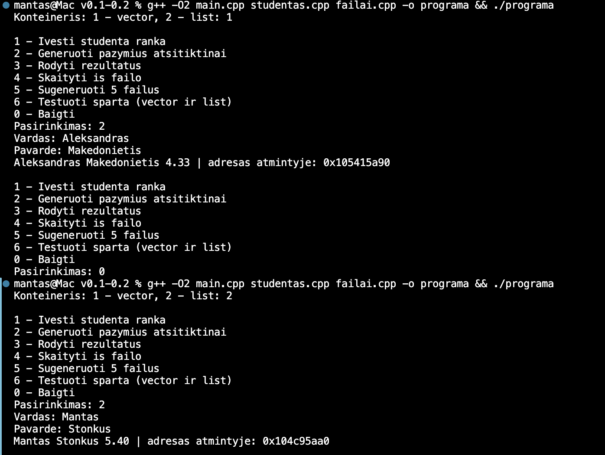

# Studentų balų skaičiuoklė

Objektinio programavimo užduotis. Programa skaičiuoja studentų galutinį balą (0.4 * ND + 0.6 * egzaminas, ND skaičiuojamas vidurkiu ir mediana), dalina studentus į vargšiukus (balas < 5) ir kietiakus (balas >= 5), generuoja testinius failus ir matuoja greitį su std::vector ir std::list.

## Diegimas

Reikia g++ kompiliatoriaus (Mac'e tinka clang, kuris ateina su Xcode Command Line Tools) ir make.

    git clone https://github.com/b4rtak/v0.1.git
    cd v0.1
    git switch v1.0
    make
    ./programa

make sukompiliuoja programą pagal Makefile. Komanda make clean ištrina sukompiliuotą programą ir rezultatų failus.

Windows'e, jei make neįdiegtas, galima kompiliuoti tiesiogiai:

    g++ -O2 main.cpp studentas.cpp failai.cpp -o programa
    .\programa

## Naudojimas

Paleidus programą reikia pasirinkti konteinerį: 1 - vector, 2 - list. Tada atsiranda meniu:

1 - įvesti studentą ranka (ND vedami po vieną, baigiama tuščia eilute). Įvedus parodomas studento adresas atmintyje.

2 - įvesti vardą ir pavardę, o pažymiai sugeneruojami atsitiktinai.

3 - parodyti rezultatus. Galima rinktis rūšiavimą pagal pavardę, vardą arba balą. Jei studentų daugiau nei 50, rezultatai įrašomi į rezultatai.txt.

4 - nuskaityti studentus iš failo (pvz. kursiokai.txt). Failo pirma eilutė yra antraštė, toliau vardas, pavardė, ND pažymiai ir paskutinis skaičius yra egzaminas.

5 - sugeneruoti 5 testinius failus: gen1000.txt, gen10000.txt, gen100000.txt, gen1000000.txt ir gen10000000.txt.

6 - greičio testas. Reikia pasirinkti rūšiavimo kriterijų ir dalijimo strategiją (1, 2 arba 3). Testuojami abu konteineriai su visais 5 failais, kiekvienas failas 3 kartus. Prieš tai failai turi būti sugeneruoti per 5 punktą. Vargšiukai įrašomi į vargsiukai.txt, kietiakai į kietiakiai.txt.

0 - baigti.

## Failai

studentas.h ir studentas.cpp - studento struktūra, balų skaičiavimas, įvedimas, rūšiavimas ir dalijimo strategijos.

failai.h ir failai.cpp - failų skaitymas, rašymas, generavimas ir greičio testas.

main.cpp - meniu.

Makefile - kompiliavimas su make.

## Versijos

### v.pradinė

Pirmoji versija. Studento duomenys saugomi struktūroje, ND skaičius nežinomas iš anksto (baigiama tuščia eilute). Galutinis balas skaičiuojamas vidurkiu ir mediana. Pažymius galima generuoti atsitiktinai, yra meniu.

### v.pradinė.1

Pridėtas duomenų nuskaitymas iš failo kursiokai.txt.

### v0.1

Studentai rūšiuojami pagal pavardę, stulpeliai išlygiuoti. Kai studentų daug, rezultatai rašomi į failą. Pridėtas įvesties tikrinimas (raidės vietoj skaičių). Programa atidaro dėstytojo pateiktus testavimo failus.

### v0.2

Kodas išskaidytas į .h ir .cpp failus. Programa generuoja 5 failus, dalina studentus į vargšiukus ir kietiakus, išveda juos į du failus ir matuoja kiekvieno etapo laiką. Rūšiavimo kriterijų pasirenka vartotojas.

Testuota su AMD Ryzen 5 3600X, 16 GB RAM, SSD. Laikai sekundėmis, 3 testų vidurkis, rūšiuota pagal pavardę:

| Įrašų | Nuskaitymas | Dalijimas | Rūšiavimas | Išvedimas | Iš viso |
|---|---|---|---|---|---|
| 1 000 | 0.005 | 0.000 | 0.0003 | 0.004 | 0.010 |
| 10 000 | 0.047 | 0.001 | 0.003 | 0.015 | 0.066 |
| 100 000 | 0.469 | 0.007 | 0.035 | 0.167 | 0.678 |
| 1 000 000 | 4.672 | 0.101 | 0.533 | 1.467 | 6.774 |
| 10 000 000 | 47.073 | 0.842 | 6.967 | 14.828 | 69.710 |

Daugiausiai laiko užima nuskaitymas. Padidinus įrašų 10 kartų, laikas irgi išauga maždaug 10 kartų.

### v0.3

Programa veikia su std::vector ir std::list. Funkcijos padarytos šablonais (template), kad tas pats kodas tiktų abiem konteineriams. Įvedant ranka parodomas studento adresas atmintyje.

Testuota su MacBook Air M4, 16 GB RAM, SSD. Su 10 000 000 įrašų:

| Etapas | vector | list |
|---|---|---|
| Nuskaitymas | 11.938 | 11.899 |
| Dalijimas | 0.171 | 0.325 |
| Rūšiavimas | 1.092 | 0.769 |
| Išvedimas | 2.541 | 2.545 |
| Iš viso | 15.742 | 15.538 |

Dalijimas greitesnis su vector, nes jo elementai atmintyje yra vienas šalia kito. Rūšiavimas greitesnis su list, nes perkeliamos tik rodyklės, o ne patys objektai. Bendras laikas beveik vienodas.

### v1.0

Realizuotos 3 studentų dalijimo strategijos abiem konteineriams, pridėtas Makefile, sutvarkyta repozitorija. Failų generavimas pagreitintas (eilutė surenkama į vieną string ir įrašoma vienu kartu), failai uždaromi prieš matuojant laiką. Strategijų tyrimas aprašytas žemiau.